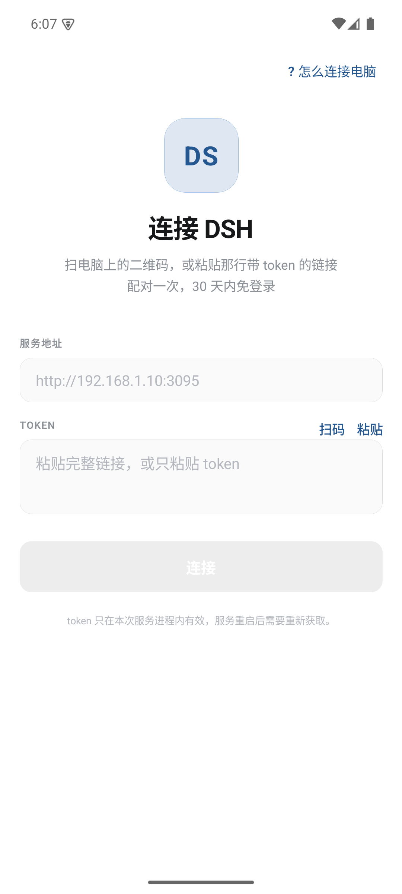
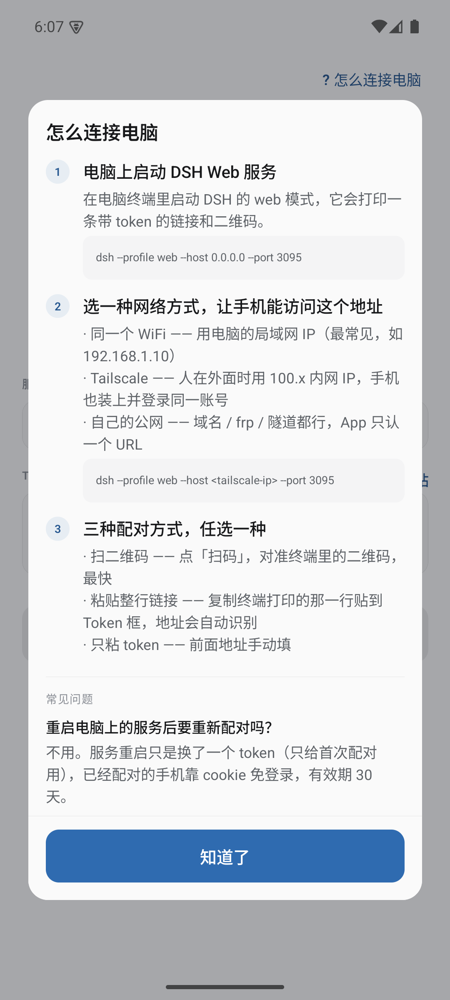
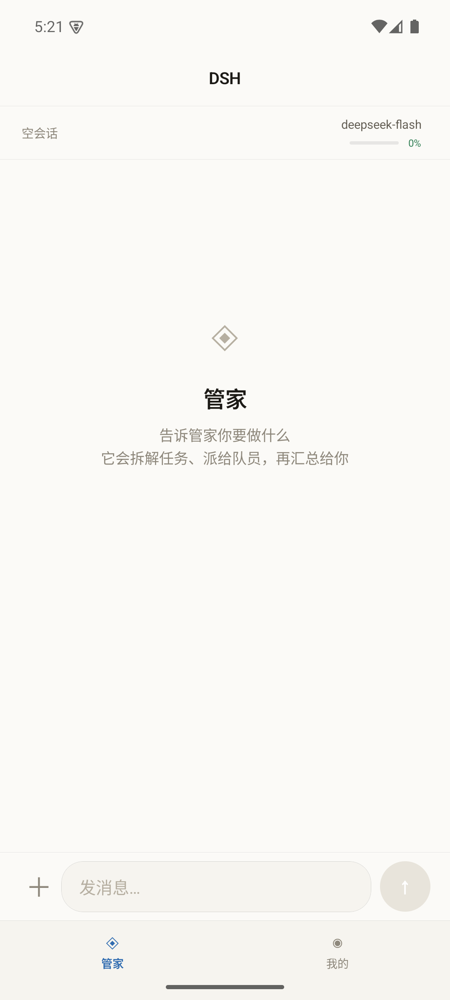
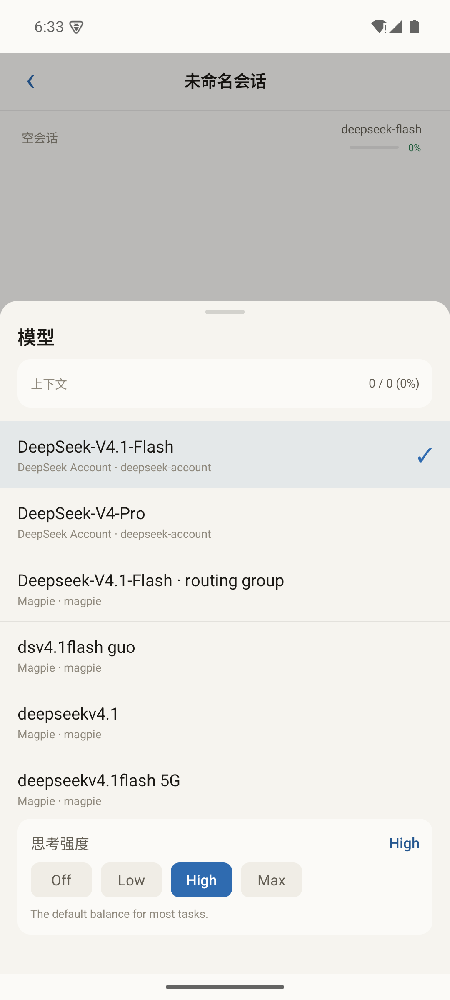
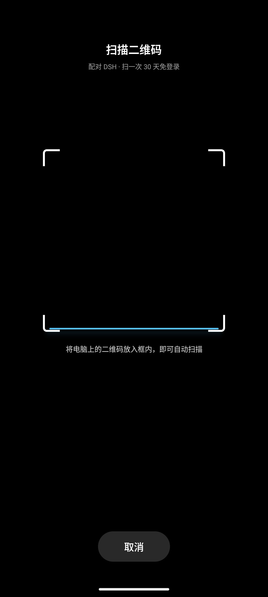

# DSH Pocket

**DeepSeek Harness 的非官方 Android 客户端 —— 把你电脑上的 AI 团队装进口袋。**

原生 App（不是网页套壳），连你自己电脑上跑的 DSH 服务：看会话、发消息带附件、切模型，
还能在手机上**回答审批**、**收系统通知**。

核心玩法是**「管家模式」**：你只跟管家说话，它拆任务、派队员去干，
你可以在手机上看着每个队员在干什么。

> ⚠️ 本项目是第三方客户端，**不隶属于 DeepSeek**。它连的是你自己电脑上运行的 DSH 服务，
> 不包含、也不分发 DSH 本体。

---

## 能做什么

### 聊天

- 流式输出、历史分页加载（长会话不会只剩「空调话」）
- Markdown 渲染：标题、列表、表格、代码块、引用
- 「已思考」可展开看完整推理过程
- 工具卡片实时显示 执行中 / 完成 / 失败
- **图片内联预览**，点击看大图
- 附件上传：手机相册的图、拍照
- 切模型、看上下文用量

### 管家模式

- 首页变成跟管家对话，**活派给队员干**
- 「闲聊 / 计划」双模式：闲聊不派活，计划会拆任务
- 底部队员头像条，实时显示谁在干什么、谁完成了
- 独立**任务看板**，按 进行中 / 待办 / 已完成 分组
- 队员全干完后自动唤醒管家做汇总
- 按项目复用队员，不重复创建

### 审批（不用再去电脑上点）

- 需要授权时手机弹出横幅，直接点「拒绝」/「允许一次」
- 审批到达时推送通知 + 震动
- 「我的 → 连接 → 审批通道」能看到连接状态和失败原因

### 通知

- **系统通知**：App 在后台也能收到，锁屏可见
- 点通知直接跳回对应会话（含冷启动）
- 管家同时跑多个任务时都会提醒
- 应用内横幅：顶部滑入，3.5 秒自动消失

### 操作手感

- **边缘手势返回**：从左边缘往右滑，页面跟着手指走
- 三套主题：纯白 / 暖白 / 深色，随时切换
- 全原生交互，无 react-navigation 依赖

### 连接方式

| 场景 | 方式 | 手机要装什么 |
|---|---|---|
| 同一个 WiFi | 局域网直连 | 什么都不用装 |
| 在外面也要用 | [Tailscale](https://tailscale.com/download) | Tailscale App |
| 在外面用、手机不想装东西 | Cloudflare 隧道 | 什么都不用装 |

扫码配对一次，**30 天内免登录**。

---

## 它长什么样

| 配对页 | 连接帮助 | 管家首页 |
|---|---|---|
|  |  |  |
| 扫码 / 粘贴 / 手填 | 三种网络方式都写清楚 | tab 变成「管家 / 我的」 |

| 模型 + 思考强度 | 扫码配对 | 启动页 |
|---|---|---|
|  |  |  |

---

## 5 分钟上手

### 1. 电脑上装 DSH

去 [DeepSeek Harness 官网](https://www.deepseek.com/harness/) 下载安装桌面端。
装好后终端里应该能用 `dsh` 命令。

### 2. 启动 Web 服务

**先跑一次自检**，确认依赖都就绪：

```powershell
cd <本仓库目录>
.\doctor.ps1
```

它会把 `dsh` / `cloudflared` / `node` 的查找结果、端口占用、状态文件一次性列出来，
哪里不对会直接告诉你怎么办。

**然后启动**

```powershell
cd <本仓库目录>
powershell -NoProfile -ExecutionPolicy Bypass -File .\start-dsh-web.ps1
```

脚本会自动挑一个手机能访问的地址（装了 Tailscale 就用 tailnet IP，否则用局域网 IP），
启动服务，并打印一条带 token 的链接和二维码。

**如果走局域网，脚本会检查 Windows 防火墙**：没放行时会打印提示和一条命令，
照着在管理员 PowerShell 里执行一次即可（或加 `-AllowFirewall` 让脚本自己加）。
不放行的话手机端会一直「连接失败」，这个坑很难自己想到。

常用参数：

```powershell
.\start-dsh-web.ps1 -Bind lan         # 强制局域网（同一 WiFi）
.\start-dsh-web.ps1 -Bind tailscale   # 强制 Tailscale（人在外面时）
.\start-dsh-web.ps1 -Host 0.0.0.0     # 自己配了 frp / 隧道时
.\start-dsh-web.ps1 -AllowFirewall    # 局域网模式下自动放行防火墙（需管理员）
.\start-dsh-web.ps1 -Port 3095 -NoQr
```

> macOS / Linux 用户：直接用 `dsh --profile web --host <你的IP> --port 3095`，
> 然后把终端打印的 URL 拿到手机上。一键脚本目前只有 Windows 版。

### 3. 手机上装 APK

从 [Releases](../../releases) 下载最新的 `app-release.apk`，允许「安装未知来源应用」后装上。

### 4. 配对

打开 App，三种方式任选：

| 方式 | 说明 |
|---|---|
| **扫码**（推荐） | 点「扫码」，对准电脑终端里的二维码 |
| **粘贴整行链接** | 复制终端打印的那一行贴到 Token 框，地址会自动识别 |
| **只粘 token** | 地址手动填 |

配对一次，**30 天内免登录**。服务重启换了 token 也不用重新配对。

---

## 网络怎么选

App 只认一个 URL，所以局域网、Tailscale、Cloudflare 隧道都能用：

| 场景 | 地址 | 前提 |
|---|---|---|
| **同一个 WiFi** | `http://192.168.x.x:3095` | 什么都不用装，最简单（**需要放行防火墙**） |
| **在外面也要用** | `http://100.x.x.x:3095` | 电脑和手机都装 [Tailscale](https://tailscale.com/download)，登录同一账号 |
| **在外面用、手机不想装东西** | `https://xxx.trycloudflare.com` | 电脑上跑 `start-tunnel.ps1`，**手机端零配置** |

脚本默认优先 Tailscale（有就用），没有就用局域网。用 `-Bind` 可以强制指定。

### Cloudflare 隧道（手机什么都不用装）

Tailscale 要在手机上装 App，Cloudflare 隧道不用——就是一个普通 HTTPS 网址。

```powershell
.\start-tunnel.ps1          # 启动隧道（约 60-90 秒）
.\start-tunnel.ps1 -Status  # 看当前隧道
.\start-tunnel.ps1 -Stop    # 停止
```

脚本会自动：探测本机地址 → 起 cloudflared → 拿域名 → **用 `--trusted-host` 重启 DSH** → 抓新 token → 验证连通。

两点注意：

- **快速隧道的域名每次重启都会变**，变了手机要重新配对。想要固定域名得有自己的域名并配命名隧道。
- **开启隧道会重启一次 DSH**，之前的配对 cookie 会失效（cookie 绑定了 authority）。

> 为什么必须加 `--trusted-host`：DSH 的 Host/Origin 校验默认只接受绑定的那个 IP，
> 通过隧道访问时 Host 是 `xxx.trycloudflare.com`，不在信任列表里就会 **403 forbidden**。
> 它只做精确匹配、不支持通配符，所以必须拿到域名之后再重启服务。

### 插件：桌面端一键连接

装了 [`dsh-plugin-connect`](dsh-plugin-connect/) 之后，DSH 网页侧边栏底部会出现「📱 手机连接」：

- 显示局域网 / Cloudflare 两个地址，各带二维码
- 点「启动隧道」直接起 cloudflared（需要先跑一次 `start-tunnel-service.ps1`）
- **IP 变了会显眼提示并给「一键修复」**——家用 WiFi 是 DHCP，地址会漂，漂了 DSH 就绑不上（`EADDRNOTAVAIL`），手机连不上而用户只看到「连不上」

```
http://192.168.x.x:3095  ─┐
                          ├─→  📱 手机连接  →  两种方式 + 二维码 + [启动隧道]
https://xxx.trycloudflare ─┘
```

### 开机自启

```powershell
.\setup-autostart.ps1          # 配置（DSH Web + 隧道服务）
.\setup-autostart.ps1 -Show    # 查看
.\setup-autostart.ps1 -Remove  # 取消
```

用启动文件夹实现，不需要管理员权限，登录即启动。

### 手机端审批（强烈建议装）

不装的话，手机上只能**看到**审批提示，点不了按钮。装了移动网关插件后，
审批卡片上直接出现「拒绝 / 允许一次」，在手机上就能决定。

```powershell
.\setup-gateway.ps1
```

它做三件事：装 `dsh-plugin-mobile-gateway`、写配置、重启 DSH。

装好之后：

- 手机 App 自动申请配对，审批通道常驻连接（不用进聊天页才连）
- 审批卡片上直接出现「允许一次 / 拒绝」按钮
- 审批到达时手机推送通知 + 震动
- 「我的 → 连接 → 审批通道」能看到 已连通 / 未连通 和具体原因

> **为什么必须要插件**：DSH 的审批是 Host 侧 waterfall，结果靠 Remote Event
> 监听器的**返回值**回传，没有 HTTP RPC 可调（12 个候选端点名全部 not found）。
> 这个插件在 Host 内部接入 waterfall，再用独立 WebSocket 投影给手机。
>
> **真机排查**：如果「审批通道」显示未连通，把后面那行原因发出来。
> 常见的是 `连接被关闭 1006 ... 401 Unauthorized`（凭据失效，App 会自动重新配对）
> 或 `400`（请求头没发出去）。
>
> 详细协议和配置见 [docs/mobile-gateway.md](docs/mobile-gateway.md)。

---

## 安全提醒

- **token 就是这台服务的钥匙**，拿到它就能操作你电脑上的 DSH。只发给自己的手机。
- 服务绑定 `0.0.0.0` 或局域网 IP 时，**同一 WiFi 下的其他人也可能访问到**。
  在不信任的网络里，建议用 Tailscale（端到端加密）而不是直接开局域网。
- 启动脚本的 `-PermissionMode` 默认是 `workspace-write`。
  `danger-full-access` 会关闭审批，**不建议在开放网络上使用**。
- **手机端审批等于把「授权」的按钮搬到手机上**。设备被他人拿到就能批准操作，
  建议给手机设锁屏密码。
- App 走的是明文 HTTP（Tailscale 内部已是 WireGuard 加密）。
  如果你用自己的公网，请务必套一层 HTTPS。

---

## 已知限制

| 项 | 说明 |
|---|---|
| **协议无版本协商** | 用的是逆向出来的 DSH 内部 RPC（见 [docs/protocol-notes.md](docs/protocol-notes.md)）。DSH 升级后某些功能可能失效 |
| **只支持 Android** | iOS 需要 Mac + 签名，暂未提供 |
| **管家模式依赖 Agent Teams** | 需要 DSH 装了 agent-team 相关 profile，且子代理工具是启用状态 |
| **通知在 App 被杀后收不到** | 用的是本地通知（不是远程推送）。安卓会杀后台，杀掉后就收不到了。真要做到杀进程也能收，得接厂商推送通道（小米/华为/OPPO 各一套 SDK），工作量远超本项目 |
| **Cloudflare 隧道域名会变** | 快速隧道每次重启换域名，手机要重新配对。固定域名需要自己的域名 + 命名隧道 |
| **审批不支持「始终允许」** | 协议只有一次性决定（`allowed-once` / `rejected`）。要长期放行请调权限模式 |
| **图片首次加载要 1-2 秒** | 完整下载到本地后再显示，还没做渐进式加载 |

---

## 配置

**不配置也能跑** —— 默认值从脚本位置和 `%LOCALAPPDATA%` 推导，代码里没有写死盘符。

需要改的时候用环境变量：

| 变量 | 默认 | 说明 |
|---|---|---|
| `DSH_POCKET_ROOT` | 脚本所在目录 | 仓库根 |
| `DSH_STATE_DIR` | `%LOCALAPPDATA%\dsh-pocket` | 状态文件目录 |
| `DSH_CLI` | 自动查找 | `dsh.cmd` 路径 |
| `DSH_CLOUDFLARED` | 自动查找 | `cloudflared.exe` 路径 |
| `DSH_WEB_PORT` | `3095` | DSH Web 端口 |
| `DSH_TUNNEL_PORT` | `3199` | 隧道控制服务端口 |

改完可以随时用 `.\doctor.ps1` 验证路径解析对不对。

完整说明见 [docs/configuration.md](docs/configuration.md)。

> **安全提醒**：状态目录里的 `tunnel.json` / `pairing.json` **含 token**，
> 拿到就能操作你电脑上的 DSH。别提交、别外传。

---

## 开发

```bash
cd dsh-mobile
npm install
npm test              # 231 项单测 + typecheck
npm run android       # 需要 Android SDK + JDK 21
```

测试覆盖：协议 fold、cwd 解析、配对、更新器、队员、文件引用、归档过滤、
审批、交付物、通知、审批网关、图片渲染、手势、网关连接。

- 应用代码在 [`dsh-mobile/`](dsh-mobile/)，架构与实现细节见 [dsh-mobile/README.md](dsh-mobile/README.md)
- DSH 内部协议（RPC 形状、投影字段、踩过的坑）见 [docs/protocol-notes.md](docs/protocol-notes.md)
- **真机验证清单**见 [docs/device-checklist.md](docs/device-checklist.md)

### 目录

```
.
├── dsh-mobile/           # React Native App（TypeScript）
│   ├── src/
│   │   ├── core/         # 协议层：transport / rpc / fold / store（不依赖 UI）
│   │   ├── nav/          # 手写导航栈 + 边缘手势
│   │   ├── screens/      # 页面
│   │   ├── components/   # 组件
│   │   └── design/       # 主题 token
│   └── tests/            # Node 单测（231 项）
├── dsh-plugin-connect/   # 桌面端插件：侧边栏「手机连接」+ 二维码
├── docs/                 # 协议笔记、真机验证清单、截图
├── start-dsh-web.ps1     # Windows 一键启动脚本
├── start-tunnel.ps1      # Cloudflare 隧道
└── setup-gateway.ps1     # 安装移动网关（手机端审批）
```

---

## 版本

当前 **v0.6.3**。完整变更见 [Releases](../../releases)。

最近的几个版本：

| 版本 | 内容 |
|---|---|
| **v0.6.3** | 手机端审批可用了（修了 WS 请求头、端点选择、凭据自愈三个问题）+ 手势真正生效 |
| v0.6.2 | 图片终于能显示（`overflow:'hidden'` 在 Fabric 下会把 Image 裁成 0） |
| v0.6.1 | 系统通知（通知栏可见，后台也能收） |
| v0.6.0 | 边缘手势返回、应用内通知横幅 |
| v0.5.4 | 会话加载失败不再只显示「空调话」，会把错误说出来 |

---

## 许可

[MIT](LICENSE)

DeepSeek Harness 及其相关商标归杭州深度求索人工智能有限公司所有。
本项目与该公司无隶属关系，也未获得其背书。
