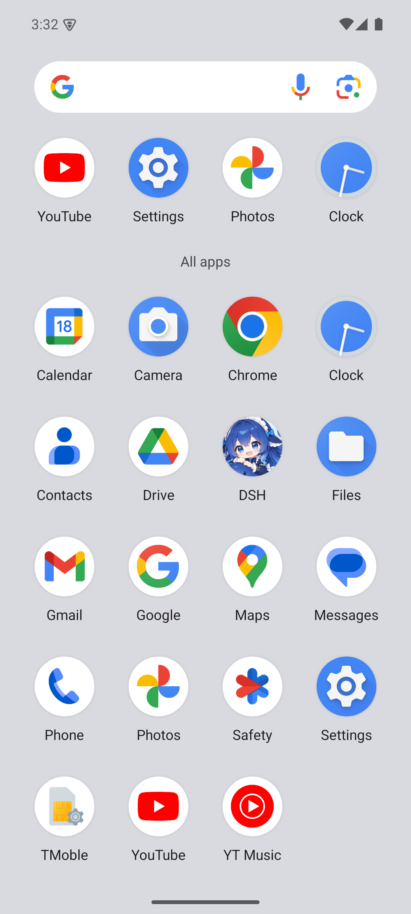

# DSH Pocket · 开发记录

> 这是**开发日志**，不是上手文档。安装和使用请看 [根目录 README](../README.md)。
>
> 这份文档按轮次记录了 App 是怎么一点点长出来的：每个功能的设计取舍、
> 实测踩到的坑、协议字段的真实形状。想改代码或者排查问题，从这里看起。

---
# dsh-mobile

DSH 的原生移动客户端（React Native）。三层导航：**工作区 → 会话 → 聊天**，
首页底部还有两个 tab：**工作区 / 我的**（微信式结构，进入会话后整屏压栈、tab 栏隐藏）。
界面全部原生控件（`Pressable` / `TextInput` / `Modal` / `ScrollView`），
数据来自电脑上运行的 `dsh --profile web` 服务。

## 当前状态

| 部分 | 状态 |
|---|---|
| 协议层（认证 / unary / 流式） | 完成，端到端实测 20 项全过 |
| 事件 fold（turn/step/block 归组） | 完成，单测 31 项全过 |
| 状态管理（Store） | 完成 |
| 三层导航 UI | 完成 |
| **视觉系统重构** | **完成**（令牌 + 基础组件 + 四个页面全部重做） |
| 气泡折叠 + 渐变遮罩 | 完成（三段渐隐） |
| 思考三点 + 思考折叠面板 | 完成（脉冲动画 + 左侧竖线） |
| 工具调用卡片 | 完成（图标徽章 + 状态色 + 等宽摘要） |
| TypeScript 类型检查 | 通过（`tsc --noEmit` 无错误） |
| **Android 真机（模拟器）验证** | **完成**，见下节 |
| 模型切换器 + token 量表 | **完成**（UI + 数据实测通过） |
| **手机专属会话** | **完成**（新建 → 发消息 → 桌面端执行，全链路实测） |
| **主题切换（纯白 / 暖白 / 深色）** | **完成**，运行时切换 + 持久化，三套色板全部实测 |
| **底部 tab 栏（工作区 / 我的）** | **完成** |
| **「我的」页（余额 + token 用量 + 外观）** | **完成**，余额/用量为真实数据 |
| **工作区改名 + 自定义 emoji 头像** | **完成**（长按工作区 → 底部弹层） |
| **附件：发图片 / 发文件** | **完成**，图片内联 base64、文件走上传回执；历史回显实测通过 |
| **桌面端会话同步** | **完成**（建会话从 `cwd` 改为 `workspaceId`，注册表登记实测通过） |
| **管家模式（MVP）** | **完成**：首页切管家 + 顶部头像条 → 浮动卡片 → 队员事件流（三级跳）；管家页只留对话，人格已注入 |
| 流式 diff 查看器 | 未做（`workspace/changes` 无 diff 内容，数据源不足） |
| 拖拽排序会话列表 | 未做 |

## 视觉系统

借鉴 `open-claude-ui` 的**页面元素结构与交互动画**，但配色不用它的陶土橙——
这里用**中性白底 + 深蓝强调色**。底色偏白，并提供三套可切换色板。

### 色板与主题（`src/design/theme.tsx`）

颜色不再是模块级常量，而是走 `ThemeProvider` + `useTheme()`：

```tsx
const tv = useTheme();
const styles = useMemo(() => makeStyles(tv), [tv]);   // 每个组件一份，随主题重建

function makeStyles(tv: ReturnType<typeof useTheme>) {
  const C = tv.colors;
  return StyleSheet.create({ root: { backgroundColor: C.bg } });
}
```

| 模式 | 背景 | 说明 |
|---|---|---|
| `light` 纯白 | `#ffffff` | 默认，最干净 |
| `warm` 暖白 | `#fbfaf7` | 纸张感，长时间读更柔和 |
| `dark` 深色 | `#0f1115` | 夜里用 |

选中的模式写进 AsyncStorage（`@dsh/themeMode`），重启后保持；
状态栏 `barStyle` 跟着 `isDark` 切。

### 令牌（`src/design/tokens.ts`）

非颜色令牌（圆角 / 间距 / 字号 / 动效）与主题无关，直接导出常量；
颜色按模式分三套 `Palette`（`lightPalette` / `warmPalette` / `darkPalette`）。
下表是**纯白**那套：

| 类别 | 内容 |
|---|---|
| 背景 | 5 级灰阶：`#ffffff` → `#fafafa` → `#f4f4f5` → `#ededee` → `#e6e6e8` |
| 文本 | 4 级：`#17181a` / `#5f6368` / `#8b8f96` / `#b4b8be` |
| 强调色 | 深蓝 `#2f6bb0` + 淡底 `rgba(47,107,176,0.09)` |
| 圆角 | 4 / 8 / 12 / 16 / 18（气泡）/ 999（胶囊） |
| 语义色 | success / warning / danger 各配 wash 背景色 |
| 状态栏 | 浅色底 + 深色图标（`barStyle="dark-content"`） |

### 借鉴的元素与动效

| 来自 CDS | 本项目实现 |
|---|---|
| 卡片式会话行 | 圆角卡 + 细描边 + 胶囊标签 |
| 长文本折叠 + 渐变遮罩 | 三段半透明叠加（RN 无 mask-image） |
| 三点跳跃指示器 | Animated 循环，1.6s + 相位错开 180ms |
| 思考折叠面板 | 左侧竖线 + Animated 淡入上滑 |
| 折叠展开动效 | `ui.tsx` 的 `Collapse`（**不是** LayoutAnimation，见下） |
| 工具调用卡片 | 图标徽章 + 状态色 + 等宽参数摘要 |
| 按压反馈 | `pressed` 态降低不透明度 / 换背景色 |

### 基础组件（`src/components/ui.tsx`）

RN 没有 CSS gradient，用**多层半透明 View 叠加**模拟：

- `GradientFill` —— 渐变底
- `Avatar` / `Tile` —— 圆形/方形渐变图标
- `Card` / `Pill` / `Dot` / `Divider` / `SectionLabel`

### 各页面设计

| 页面 | 关键设计 |
|---|---|
| 配对页 | 居中品牌区（DS 蓝色渐变方块）+ 上标签下输入框 + 主按钮 |
| 工作区列表 | **品牌字标 `DSH`** + 统计副标题，渐变方块图标（可换 emoji），右侧箭头，行间细分割线；**长按**打开设置弹层 |
| 会话列表 | **卡片式**，手机会话带蓝色「手机」标签，胶囊显示模型/上下文 |
| 聊天 | 用户气泡右对齐，助手文本左对齐，思考面板带**左侧竖线**，工具卡带**图标徽章**，输入区胶囊状；左侧 `＋` 可发图片/文件，附件显示在气泡上方 |
| 我的 | 余额卡（主余额 / 赠金 / 合计 + 去充值/用量明细）、token 用量三栏、外观三档分段控件、连接信息、退出登录 |
| 底部 tab | 工作区 / 我的，两等分，激活色 `accent` + 字重加粗，仅首页存在 |
### 截图（模拟器实测）

| 配对页 | 连接帮助 | 管家首页 |
|---|---|---|
|  |  |  |
| 扫码 / 粘贴 / 手填 | 三种网络方式都写清楚 | tab 变成「管家 / 我的」 |

| 扫码配对 | 启动页 | 应用图标 |
|---|---|---|
|  |  |  |
| 微信式取景框 | 鲸尾图满屏 | 自适应图标 |

> 更多截图（工作区、聊天、团队、附件等）需要连上真实 DSH 才能拍，
> 仓库里只保留不含任何个人数据的这几张。
### Android 主题

`android/app/src/main/res/values/styles.xml` 固定为
`Theme.AppCompat.Light.NoActionBar` + 白色窗背景 —— **不能用** `DayNight`，
否则系统切深色时会露出黑底，和 app 自己的主题打架。

app 内的深色是**自己控制**的（三套色板），不跟系统设置联动：
这样"纯白/暖白"这两个非系统档位才能稳定存在。


## 这一轮加的三件事

### 1. 主题切换

`src/design/theme.tsx` 的 `ThemeProvider` 提供 `mode / colors / setMode / modes`；
`App.tsx` 启动时从 AsyncStorage 读回上次的模式，切换时写回。
所有组件（含 `ui.tsx` 的 `Avatar` / `Tile` / `Card` 等）都改成 `useTheme()` + `makeStyles(tv)`，
没有模块级静态样式表残留 —— 否则切主题时那些颜色不会跟着变。

### 2. 底部 tab（工作区 / 我的）

`src/screens/HomeScreen.tsx` 持有 `tab` 状态，渲染 `WorkspacesScreen` 或 `ProfileScreen`，
底部 `src/components/TabBar.tsx`。**tab 只在首页存在**：进入会话列表/聊天由 `NavHost` 压栈，
整屏覆盖，tab 栏自然消失（和微信一致）。

### 3. 工作区改名 + 自定义头像

DSH 的工作区就是 `cwd`，路径本身改不了，所以这是**纯客户端展示层覆盖**：

- 存在 `AsyncStorage` 的 `@dsh/workspaceCustom`，key 是归一化后的 cwd
- 长按工作区行 → `src/components/WorkspaceSheet.tsx`（原生 `Modal` + `TextInput`）
- 可改名字（最长 24 字）、从 16 个 emoji 里选头像、"恢复默认"清空
- 自定义名会带到会话列表的标题；真实路径仍显示在行下方，不会被藏起来

### 「我的」页的数据来源

| 数据 | 来源 |
|---|---|
| 余额 | `account/getBalance`（主钱包 + 赠金钱包分列，合计为主数字） |
| 充值 / 用量明细链接 | `account/getState` 的 `links.topUpUrl` / `links.usageUrl` |
| token 用量 | 所有会话 `projections.values.tokenUsage` 累加（输入 / 输出 / 缓存读 / 缓存写） |
| 连接状态 | 进页面时 `store.ping()` 真打一次（**不要**用 `store.connection`，那是聊天流的 WS 状态，在「我的」里恒为 idle） |
| 外观 | `useTheme()` |

## 第二轮优化

### 1. 首屏字标改成 `DSH`，并做视觉对齐

标题原来是「工作区」（两字 CJK）。换成三个拉丁大写后有个坑：
**同样 `fontSize` 下，拉丁大写的光学高度只有 CJK 的 ~72%**，直接换会显得小一圈。
所以字标单独用 `fontSize: 30 / lineHeight: 34 / letterSpacing: 1.4`（原 CJK 是 26 / -0.5），
放大 + 正字距把视觉重量补回来；左边缘仍与列表行图标对齐（都从 `layout.screenPadding` 起）。
副标题「N 个目录 · M 个会话」和右侧「退出」的相对位置不变。

> 底部 tab 仍然写「工作区」——标题是品牌，tab 是分区名，两者职责不同。

### 2. 两个 tab 都常驻挂载

`HomeScreen` 不再用三元切换渲染，而是两个 pane 同时挂载、只给隐藏的那个
`display: 'none'`。好处：

- 切回「工作区」时**滚动位置不丢**（之前会重置到顶部）
- 「我的」的余额/用量在启动时就在后台拉好了，点进去是现成的，不用看转圈

### 3. 余额 TTL 缓存 + 只在可见时自检

- `Store` 新增 `balanceFetchedAt` / `balanceFresh(ttl = 90s)`；命中 TTL 就不再请求
- 余额接口实测要 2–5 秒，这样重进「我的」是秒开的；下拉刷新会强制绕过 TTL
- 连通性 `ping` 只在 tab 真正可见时才打，启动时不浪费一次往返
- 同时给 `loadAccount()` / `loadSessions()` 加了**重入保护**——两个 pane 一起挂载时
  不会打两次相同的请求

## 第三轮：导航栈保持挂载 + 折叠动画修复

### 1. `NavHost` 不再只渲染栈顶

原来的实现 `render(stack[stack.length - 1])`，压栈时把下层屏幕整个卸载，
所以「会话列表滚到一半 → 进聊天 → 返回」会回到列表顶部，并重新拉一遍数据。

现在改成**整个栈都渲染，只有栈顶可见**（其余 `display: 'none'` + `pointerEvents: 'none'`
+ `importantForAccessibility: 'no-hide-descendants'`）：

```tsx
{stack.map((screen, i) => (
  <View key={`${i}-${screen.name}`} style={[styles.screen, i === topIndex ? null : styles.hidden]}>
    {render(screen)}
  </View>
))}
```

效果：返回时滚动位置、tab 选择、列表内部状态全部保留，也没有重新请求的闪烁。
这也是 react-navigation 的标准行为。（顺带说明：tab 状态其实不用提到 `App` 层，
只要 `HomeScreen` 不被卸载就够了。）

出栈时被弹出的屏幕仍会正常卸载，`ChatScreen` 的 `store.closeChat()` 清理逻辑不受影响。

### 2. 折叠动画换成 Animated（Fabric 下 LayoutAnimation 是 no-op）

排查 LogBox 的 `setLayoutAnimationEnabledExperimental is currently a no-op in the
New Architecture` 警告时发现的真问题：RN 0.81 默认开 Fabric，
`LayoutAnimation.configureNext()` **根本不生效** —— 也就是说思考面板和工具卡
「展开有高度过渡」这个从 open-claude-ui 借鉴来的动效，其实一直是瞬变的。

修法：删掉 `LayoutAnimation` 和那段 `UIManager` 开关，在 `ui.tsx` 里加一个
`Collapse` 组件，用 `Animated` 做**淡入 + 上滑**（`useNativeDriver: true`）：

- 不测量内容高度，所以不用担心「展开后文本还在流式增长」导致高度失效
- 走 native driver，不占 JS 线程
- 展开和收起都生效


## 第四轮：附件（发图片 / 发文件）

聊天输入框左边加了 `＋`，弹出「图片 / 文件」选择；选中的东西先进待发送条
（图片给缩略图、文件给名称+大小，都能单独移除），发送时按类型分流。

### 两条完全不同的上传路径

协议是实测出来的（`docs/protocol-notes.md` §2.4），**图片和文件不能互换**：

| 类型 | 发法 | 为什么 |
|---|---|---|
| 图片 | 读成 base64，直接内联进 `session/prompt` 的 `{type:'image', mediaType, data}` | `{type:'image', receiptId}` 会被 wire 校验拒绝 |
| 文件 | 先 `POST /api/session/uploadFileBinary` 拿 `receiptId`，再发 `{type:'file', receiptId}` | 文件没有内联形式 |

上传用 `react-native-blob-util` 的 `wrap(path)`，**从磁盘流式发**，不把文件读进 JS 内存
（手机原图十几 MB，base64 进内存很容易 OOM）；只有图片为了内联才读 base64。

### 历史图片怎么显示

会话记录里只有 `attachmentId`（`user/message` 存的是 `{type,attachment:{…}}`，
输入的 `receiptId` 不会保留）。所以历史图片要走
`session/attachment {request:{sessionId, attachmentId}}` 把字节取回来：

- `src/core/attachment-cache.ts` 做三级处理：结果缓存 / 并发合并 / 失败记负缓存
- 刚发出的消息自带 `localUri`，立刻显示，不用等网络
- 图片宽高直接用 Host 解析出的 `width`/`height` 定比例，加载完不会跳版

### 踩到的两个坑

1. **`session/attachment` 的参数要包一层 `request`**，平铺传会报
   `gateway/arguments-invalid: missing "request"`（和 `session/page` 一样，
   但 `account/*` 那些是平铺的，容易混）
2. **横向 ScrollView 放在列容器里会把高度撑开**，导致图片和气泡之间出现一大段空白
   —— 图片行改成 `flexWrap` 换行解决

### 新增依赖

| 包 | 用途 |
|---|---|
| `@react-native-documents/picker` | 选图片/文件（Android 走 SAF，`mode:'import'` 会复制到 app 缓存并给 `file://` 路径） |
| `react-native-blob-util` | 读本地文件 base64 + 裸路径流式上传 |

两个都是原生模块，改完要重新 `assembleDebug` 装包（不是纯 JS 改动）。


## 第五轮：桌面端会话同步（建会话用 workspaceId）

### 症状

手机 App 里新建的会话，电脑上的桌面端看不到，两边使用不连贯。

### 先排除「数据没同步」

两边用的是**同一个** `~/.dsh` 库，手机建的会话就在磁盘上：

```
C:\Users\<you>\.dsh\sessions\--E-work-dsBot--\session-<id>\session.v4.jsonl.zstd
```

所以不是文件同步问题。

### 真因：会话有两份清单

| 来源 | 内容 |
|---|---|
| `session/list` | 扫磁盘，返回**全部**会话（App 读的是这个） |
| `~/.dsh/storages/workspace.json` | **工作区注册表**，记录每个工作区登记了哪些会话（桌面端按这个渲染） |

实测发现注册表里 `C:\work\demo` 只登记了 **2** 个会话，而磁盘上有 47 个。
原因是 `session/create` 只传 `cwd` 时，会话会落盘但**不会登记**进注册表：

```jsonc
{ "request": { "cwd": "C:\\work\\demo" } }          // ❌ 磁盘有、注册表没有
{ "request": { "workspaceId": "866e0b64-…" } }       // ✅ 两边都有（sessionIds +1）
```

### 修法

`Store.createSession()` 改成：先用 `workspace/create { path }` 解析出 `workspaceId`
（幂等，已存在时返回 `created:false`），再用 `workspaceId` 建会话；
解析失败时退回原来的 `cwd` 方式（会话照样能建，只是桌面端暂时看不到，不阻塞用户）。

实测：App 里点「新建」后，注册表 `sessionIds` 从 4 → 5，新会话 id 出现在列表最前面。
用 `workspaceId` 建的会话在 `session/list` 里的 `cwd` 仍然正确，所以工作区分组不受影响。

### 补不回来的部分

**已经漏登记的历史会话没有补救接口**（都试过）：

| 尝试 | 结果 |
|---|---|
| `session/create { workspaceId, sessionId: 已有 }` | 返回**新** id，又建了个空白会话，不接管旧的 |
| `workspace/insertSessionBefore { workspaceId, sessionId }` | `workspace/move-invalid: … the session is not accounted` |

所以本次修复只对**之后新建**的会话生效；之前那批（包括我测试留下的）在桌面端仍然看不到。


## 第六轮：管家模式（MVP）

「我的」里开一个开关，首页就从「工作区列表」变成「跟管家对话」；管家自己拆任务、
派队员去做，队员在同一个会话的投影里可见。

### 前提验证（先做，因为这决定方案）

问题：App 通过 `dsh --profile web` 建出来的会话，到底有没有 Agent Teams 工具？

结论：**有，而且不需要自定义 preset**。Agent Teams 是 **profile 级**开关
（`@deepseek-ai/dsh-experimental-agent-team-profile`，web / desktop 两个 profile 都装了），
不是按会话开关的。

证据不需要花 token —— 会话的 `request/header` 事件里带着完整工具 schema，
直接从里面数：

```
工具数 37，其中 Agent Teams 全套 8 个：
spawn_teammate, send_message, list_agents, interrupt_agent,
wait_agent, team_task_create, team_task_get, team_task_list, team_task_update
```
（脚本：`../probes/list-session-tools.mjs`）

### 做了什么

| 部分 | 说明 |
|---|---|
| 开关 | 「我的」→ 管家模式，原生 `Switch`，状态持久化 |
| 首页形态 | tab 变成 `管家｜我的`，首页直接是管家对话；工作区列表退到「我的 → 工作区」 |
| 管家会话 | 首次开启时自动建，持久化 sessionId；cwd 取「最近活跃的工作区」，这样派出的队员落在用户正在做的项目里 |
| **管家页 = 纯对话** | 只在管家页隐藏工具卡和思考面板，只留「用户说的话 + 管家的回复」；技术细节留给队员事件流 |
| **顶部头像条** | 管家页标题下方一排队员头像：环色区分「进行中 / 待命 / 已完成 / 失败」，右侧一行「N 在干活 · M 已完成」 |
| **浮动卡片** | 点头像条弹出浮层，卡片式列出每名队员：头像、状态胶囊、一句「在干什么」 |
| **队员事件流** | 再点卡片才进入该队员的执行记录（只读，无输入框） |
| **一直能聊天** | 管家派完活立刻回话，不 `wait_agent` 阻塞；用户在它干活时继续发消息会排队，不会被挡 |

三级跳：`头像条 → 浮动卡片（谁在干什么）→ 事件流（他到底做了什么）`
—— 和「管家只跟你聊天，活都在下面干」的产品意图一致。

`TeamStrip` / `TeamSheet` / 事件流的数据**都不用额外 RPC**：
会话投影里自带 `projections.values.agentTeam`：

```jsonc
{
  "members": [{ "id", "name", "role": "lead|teammate", "phase": "active|provisioning|failed" }],
  "tasks":   [{ "id", "subject", "status": "pending|in_progress|completed|deleted", "ownerName" }],
  "failure": "可选"
}
```

- `members[].id` **就是队员自己的 sessionId**（实测确认），所以点进事件流可以直接复用聊天页
- 「在干什么」取该成员名下 `status=in_progress` 的任务，没有就看完成了多少，再没有就是待命

### 本轮补的四件事

1. **管家页标题改成 `DSH`** —— 顶部是品牌，空态卡片里仍然写「管家」（角色）。
2. **先报方案、再等人点头**：人格提示改成两阶段 ——
   收到需求先用 2-3 行说清「准备派几个人、各自做什么」，问一句「就这样做吗？」，
   **等用户确认后才** `spawn_teammate` / `team_task_create`。
   人格文案有版本号（`BUTLER_PRIME_VERSION`），改了会重新注入。
3. **团队状态更实时**：`team/member`、`team/task` 这些增量事件**不在会话日志里**
   （`session/follow` 的 records 里一条都没有，只有投影有），所以改成
   **每 5 秒轮询 `session/list` 读 `agentTeam` 投影**，头像条/卡片/任务板都会跟着更新。
4. **独立任务板 + 完成通知**：
   - 浮层里加「查看全部任务」→ 独立页，按「进行中 / 待办 / 已完成」分组，
     每条带负责人、阻塞数、写入范围；
   - 轮询时对比前后任务状态，有任务从非完成变成 `completed` 就弹一条绿色提示
     「某人 完成了：某任务」，5 秒自动消失（`store.teamNotices`）。

### 踩到的三个坑

1. **队员会话不能直接用 `{kind:'session'}` 读**，服务端会拒：
   `session/agent-busy: subagent Sessions require their durable parent address`。
   正确地址是 `{kind:'subagent', parentSessionId, childSessionId, mode}`，
   其中 `mode` 在 `session/list` 里没有暴露，实测 `continuable` 能读到完整记录
   （176 条），所以代码里按 `continuable → one-shot → unknown` 依次降级。
2. **管家的人格没有系统提示词接口**，用「首条带标记的用户消息」注入，
   fold 层见到标记就丢掉（用户看不到这条假消息）。
3. 顶部头像条和原来的底部团队条会**同时出现**，管家页要显式关掉底部那个。

### 已知缺口

- **模型额度**：验证时账号正好被限流（`429 … WorkBuddy 使用量已超出频率限制`），
  所以「管家真的 spawn 一个队员」的端到端还没跑通；工具存在性已经用 schema 证明，
  头像条/浮层/事件流三级跳用**已有真实队伍的历史会话**验证通过。
  额度恢复后要补：新建管家会话 → 发一句「帮我看看这个需求」→ 看它派活 + 头像条变化。
- 「正在进行」目前靠任务状态推断，没接 `team/member`、`team/task` 增量事件；
  接上后状态可以更实时。
- 任务板只有浮层里的只读列表，还没有独立页面 / 完成通知。


## 第七轮：配对与退出体验

### 1. 「退出」长得像返回，一点就掉到配对页

原来工作区列表右上角有个 `退出` 文字按钮，位置和返回箭头一样，很容易误触；
而且点下去**立刻**清掉 cookie，没有任何确认 —— 这一轮改了三处：

| 改动 | 说明 |
|---|---|
| 从列表页移除 | 工作区列表右上角不再有退出，退出统一收在「我的」 |
| 二次确认 | 「我的 → 退出登录」弹原生 `Alert`（取消 / 退出） |
| 退出可恢复 | 退出时把 cookie 备份到 `@dsh/lastCookie`；配对页出现「上次的配对还在 · 直接继续」，一键恢复，不用再找 token |

### 2. 启动时不再拿网络探测决定登录态

原来的逻辑：读到 cookie 后先 `ping()` 一次，成功才算登录。
**网络抖一下 / 服务正在重启**，就会把人直接打回配对页，看起来像「莫名其妙被退出登录」。

现在改成**乐观登录**：只要有 cookie 就直接进 App，连接问题交给各页面自己显示
（「我的」里有连接状态、会话页有重试）。配对页只在真的没有 cookie 时才出现。

### 3. 配对流程简化

| 改动 | 说明 |
|---|---|
| 剪贴板识别 | 打开配对页时读一次剪贴板，认出配对链接/裸 token 就弹卡片「检测到剪贴板里的配对信息 · 一键使用」 |
| `粘贴` 按钮 | token 标签右侧加粘贴按钮，一键填好 |
| 整条 URL 也能用 | 把完整链接粘进 token 框，地址和 token 会一起解析出来，不用再分开填 |
| 文案 | 改成「把这行带 token 的链接复制过来」，明确只要一段文本 |

> 剪贴板用的是 RN 核心的 `Clipboard`（已标记废弃但可用），它在模块求值时就打警告，
> 所以 `LogBox.ignoreLogs` 必须放在 `src/setup.ts` 里、并且**先于 App 被 import**
> （`index.js` 里 `import './src/setup'` 排在 `import App` 前面）。

#### 页面说明 + 帮助卡片

原来配对页那两行说明塞得太挤，改成：

- 页面上只留一行短说明：「扫电脑上的二维码，或粘贴那行带 token 的链接」
- 帮助入口放在**右上角**（`? 怎么连接电脑`，品牌蓝小字），不占内容区
- 点开是一张**居中浮动卡片**（`components/PairingHelpSheet.tsx`，和 ConfirmSheet 同一套视觉）：
  1. 电脑上启动 DSH（带可复制的命令块）
  2. 手机和电脑连同一个 Tailscale 网络
  3. 三种配对方式：扫码 / 粘贴整行链接 / 只粘 token
  - 常见问题：重启服务要不要重配、误退出怎么恢复、一直连不上怎么查

内容超长时卡片内部滚动，按钮固定在卡片底部（有细分隔线），不会和文字叠在一起。

截图：[配对页](../docs/screenshots/25-pair-screen.png) ·
[帮助卡片](../docs/screenshots/26-pair-help.png)

### 还没做（下一步可考虑）

真正消灭「复制粘贴」只有一条路：**手机扫电脑终端上的二维码**。
需要加相机原生依赖（`react-native-vision-camera` 或 `react-native-camera-kit`），
并处理相机权限，属于一次独立改动，还没做。

### 模拟器实测（2026-10-18 晚）

| 项 | 结果 |
|---|---|
| 列表页不再有「退出」 | ✅ 标题区只剩 `DSH` + 统计 |
| 退出二次确认 | ✅ 原生 Alert，文案含「可用上次的配对恢复」 |
| 点「取消」 | ✅ 留在「我的」，仍是登录态 |
| 点「退出」 | ✅ 回到配对页 |
| 「上次的配对还在」卡片 | ✅ 显示服务地址 + 「直接继续」 |
| 「直接继续」 | ✅ 无需 token，直接回到管家首页 |
| 剪贴板识别（前台） | ✅ 卡片出现并解析出 URL / 裸 token；底部有系统「已粘贴」提示 |
| 「一键使用」 | ✅ 地址 + token 都填进输入框 |
| 「粘贴」按钮 | ✅ 能读剪贴板；内容认不出时提示「剪贴板里没有认出 token」 |

**一个真实限制**：Android 10+ 在应用**不在前台**时读剪贴板会返回空，
所以冷启动进配对页那次可能读不到剪贴板，卡片不出现。
已加处理：`AppState` 变回 `active` 时再读一次；「粘贴」按钮作为手动兜底。

> 这三处交互（退出确认、上次配对恢复、剪贴板一键配对）的截图含本机数据，未随仓库发布。


## 第八轮：品牌图 + 扫码配对

### 1. 桌面图标

用品牌图（蓝发少女 + 鲸鱼）生成：

| 资源 | 说明 |
|---|---|
| `mipmap-*/ic_launcher.png` | 48/72/96/144/192 五档（mdpi→xxxhdpi） |
| `mipmap-*/ic_launcher_round.png` | 圆形版（圆形遮罩，四角透明） |
| `mipmap-anydpi-v26/ic_launcher{,_round}.xml` | 自适应图标：前景是 108dp 画布、图缩到 70% 留安全区；背景 `#EAF4FF` |

素材与生成脚本：`assets/brand/icon-source.png` + `probes/gen-android-brand.py`。

### 2. 启动页

品牌图（鲸尾跃出海面）做成满屏启动页：

- 新增 `SplashActivity.kt`：全屏 `ImageView` + `centerCrop`，停留 **650ms** 后起 `MainActivity`
- 主题 `SplashTheme`：`windowBackground` 先铺深藏蓝，避免第一帧白闪
- 清单里把 `MAIN/LAUNCHER` 挪到 `SplashActivity`，`MainActivity` 改为 `exported=false`

**Android 12+ 的系统闪屏**（一定要出现，跳过不了）也做了处理，让它无缝过渡：
`values-v31/styles.xml` 里设置

```xml
<item name="android:windowSplashScreenBackground">@color/splash_background</item>
<item name="android:windowSplashScreenAnimatedIcon">@drawable/ic_splash_transparent</item>
<item name="android:windowSplashScreenIconBackgroundColor">@color/splash_background</item>
```

图标换成一个 1dp 全透明形状 → 系统闪屏变成**一帧纯色**；
这个颜色取的是品牌图顶部天空的 `#1C4492`，所以「纯色 → 鲸尾图」几乎看不出切换。

为什么不用 `windowBackground` 放图片：窗口背景的 bitmap 只支持 `center`/`fill`，
做不到等比裁剪铺满，`fill` 会把 2:3 的图拉变形。

### 3. 扫码配对

- 依赖：`react-native-camera-kit@18`（自带二维码识别，比 vision-camera 轻，不用 worklets）
- `components/ScanSheet.tsx`：全屏相机 + 取景框，`allowedBarcodeTypes={['qr']}`，
  打开时请求 `CAMERA` 权限；被拒或相机起不来都有兜底文案
- 配对页 token 标签右侧加了「扫码」，扫到后走同一条解析逻辑并**直接连接**
- 解析逻辑抽到 `src/core/pairing.ts`（纯函数，不依赖 RN），配 `tests/pairing-spec.mjs` 单测：
  覆盖完整链接 / 裸 token / 带引号 / 多个尾斜杠 / 认不出的输入返回 `null`

```bash
npm test          # 现在包含 fold + cwd + pairing + typecheck
```

### 4. 扫码界面：照微信做

第一版用的是 camera-kit 自带取景框（绿角+红线），和整体风格不搭。改成微信那种：

- 整屏压暗（四块半透明黑，围出中间方框）→ 相机画面只在框内可见
- 白色四角（3px 描边、圆角），没有整圈边框
- 一条天蓝色扫描线在框内**来回扫**（Animated，native driver）
- 上方标题 + 副标题，框下提示「将电脑上的二维码放入框内，即可自动扫描」

### 5. 退出确认改成自绘弹窗

系统 `Alert` 是 Material 样式，和暖白底不搭。新增 `components/ConfirmSheet.tsx`：
圆角卡片 + 细分隔线 + 双按钮（危险操作用红色），带缩放淡入动画。
全项目现在**没有一处 `Alert`**，确认类交互统一走这个组件。


### 7. 模型面板：可调思考强度

`session/modelCatalog` 里每个模型自带 `reasoning` 字段（实测结构）：

```json
{ "efforts": [{ "id": "off", "name": "Off", "description": "..." }, ...], "defaultEffort": "high" }
```

档位是**按模型不同**的：DeepSeek 系是 off/low/high/max，GPT-6-Luna 是 low/medium/high/xhigh，
所以面板里不能写死，全部按当前模型的 `efforts` 渲染。

- 面板**底部**（模型列表下方）新增「思考强度」分区：一行 chip + 当前档位说明，点任意一档即刻生效
- 顶栏保持简短：只显示 `0% deepseek-flash`（之前拼 `· High` 太长，挪到面板里了）
- 切模型时带上该模型的 `defaultEffort`（没有就用第一档），避免沿用上一个模型不存在的档位
- 会话还没显式选过模型时，用目录里的 `default` 兜底，否则空会话打开面板看不到档位

**协议坑**：投影里没有 `model` 字段，实际叫 `modelSelection`：

```json
{ "lastUsed": null, "next": { "provider": "deepseek-account", "model": "deepseek-flash", "reasoningEffort": "max" } }
```

`next` 才是「下一次对话会用」的模型和档位，`readStatus` 已改为从这里读（并兼容旧字段）。

截图：[模型 + 思考强度](../docs/screenshots/27-model-effort.png)

### 6. 巡检发现并修掉的问题

| 问题 | 处理 |
|---|---|
| 「我的 → 工作区」进去后**没有返回按钮**（只能按系统返回键） | 工作区页头加 `‹`，仅在有上一页时显示 |
| 账户余额接口偶发不返回时，「我的」页加载圈**一直转** | `loadAccount` 加 12s 超时，超时提示「余额查询超时，下拉可重试」 |
| 网络失败日志会一直打到生产环境 | 收进 `if (__DEV__)` |

### 模拟器实测（2026-10-19 凌晨）

| 项 | 结果 |
|---|---|
| 启动图标 | ✅ 应用列表里显示品牌图，名字 `DSH` |
| 启动页 | ✅ 满屏鲸尾图（`21-splash.png`）；先出现 Android 12+ 的系统图标闪屏，再进自定义启动页，650ms 后进 App |
| 扫码入口 | ✅ 配对页 Token 行右侧有「扫码」 |
| 相机权限 | ✅ 首次点扫码弹系统授权（使用期间 / 仅本次 / 拒绝） |
| 扫码界面 | ✅ 标题 + 说明 + 取景框 + 取消按钮（`23-scan-qr.png`） |
| 解析逻辑 | ✅ `tests/pairing-spec.mjs` 12 项（链接/裸 token/引号/多斜杠/非法输入） |

**没能验证的**：真实扫码解码。模拟器的 `hw.camera.back = emulated` 是虚拟场景，
拍不到真实二维码，预览也是黑的；真机上对准屏幕上的二维码才是真实链路。
解码回调 `onReadCode` 之后走的是和手填完全相同的 `parsePairingText` → `connect()`。

截图：[启动页](../docs/screenshots/21-splash.png) ·
[应用图标](../docs/screenshots/22-app-icon.png) ·
[扫码界面](../docs/screenshots/23-scan-qr.png)


在 Android 模拟器（Pixel 6 / API 35 / x86_64）上完整跑通：

| 环节 | 结果 |
|---|---|
| APK 构建 | ✅ 97.2 MB，`BUILD SUCCESSFUL` |
| 配对（token → cookie） | ✅ 拿到 `dsh-auth-*` cookie |
| **重启免扫码** | ✅ 杀进程重开直接进工作区（cookie 存 AsyncStorage） |
| 第一层：工作区列表 | ✅ 按 cwd 分组：`dsBot`(36 会话) + `default-workspace`(2 会话) |
| 第二层：会话列表 | ✅ 标题、时间、上下文百分比、sessionId 全部正确 |
| 第三层：聊天 | ✅ `session/follow` 首帧 292 条记录，fold 成 4 轮 |
| 思考折叠面板 | ✅ 显示「已思考 / 展开」，可展开可收起 |
| 工具调用卡片 | ✅ 工具名 + 参数摘要 + 状态点（绿完成 / 红失败 / 灰执行中） |
| 中断标记 | ✅ `interrupted` 分隔线 |
| 状态栏 | ✅ 轮次数 + 上下文占用 |
| **模型切换器** | ✅ 弹出面板显示 token 用量 + 7 个模型（2 个 provider 分组） |
| token 用量表 | ✅ 上下文 559.2k/1.00M (56%)、输入 1.45M、输出 318.5k、缓存 217.23M |
| 模型切换动作（桌面端会话） | ⚠️ 被单写者锁拒绝，错误已翻译成中文 |
| **新建手机专属会话** | ✅ session/create 成功，直接进入聊天页 |
| **手机发消息 → 电脑执行** | ✅ 实测：状态变「进行中」、出现思考动画、「打断」按钮 |
| **实时流推送** | ✅ 工具调用逐个出现（`list_agents` / `working_directory` / `执行命令` / `读取文件` / `team_task_list`），状态点从「执行中」变「完成」 |
| **跨设备工作区合并** | ✅ `C:\\work\\demo` 与 `C:\work\demo` 归一化为同一个工作区 |
| **底部 tab** | ✅ 工作区 / 我的切换正常，进入会话后 tab 栏隐藏 |
| **主题：纯白 → 暖白 → 深色** | ✅ 三档全部实测，整屏（含卡片/分段控件/tab 栏）同步变色 |
| **主题持久化** | ✅ 设成暖白后杀进程重开，仍是暖白 |
| **「我的」余额** | ✅ 实测 `¥5.99`（主 `¥0.62` + 赠金 `¥5.37`），与 `account/getBalance` 一致 |
| **「我的」token 用量** | ✅ 输入 1.73M / 输出 465.7k / 缓存读 398.80M / 合计 401.00M |
| **工作区改名 + emoji** | ✅ 长按 → 改成「DS Team」+ 🚀，列表行与会话页标题同步 |
| **重命名持久化** | ✅ 杀进程重开，名字和头像都还在 |
| **连接状态自检** | ✅ 显示「正常」（`store.ping()` 实测，非 WS 状态误用） |

### 主题 / tab / 我的 / 工作区自定义 实测

| 环节 | 结果 |
|---|---|
| 三套色板切换 | ✅ 无残留白块/黑块，状态栏图标跟随 |
| 重命名弹层 | ✅ 原生 Modal，emoji 网格选中态、预览名实时更新、恢复默认可用 |
| 输入框 | ✅ 聚焦、输入、`returnKeyType="done"` 提交均正常 |
| 空工作区 / 加载 / 错误态 | ✅ 三种状态都有对应 UI |
| `DSH` 字标 | ✅ 30px + 1.4 字距，与副标题/列表左边缘对齐 |
| tab 常驻 | ✅ 切回工作区滚动位置保留；「我的」点进去余额已就绪（<1s 内出数） |
| 余额 TTL / 重入保护 | ✅ 两 pane 同时挂载只打一次 `account/getBalance` |
| 导航栈保持挂载 | ✅ 会话列表滚到中段 → 进聊天 → 返回，滚动位置原样保留 |
| 折叠动画 | ✅ 思考面板 / 工具卡展开有淡入上滑；LogBox 的 LayoutAnimation 警告消失 |
| **发文件** | ✅ 挑 `notes.txt` → chip 显示 `38 B` → 发出后 Host 侧正常入库 |
| **发图片** | ✅ 挑 PNG → 内联 base64 → 气泡上方按原图比例显示缩略图 |
| **历史回显** | ✅ **杀进程重开**再进会话，文件 chip 和图片都从 `session/attachment` 正确恢复 |
| 大图预览 | ✅ 点缩略图全屏查看，点任意处关闭 |
| 类型检查 | ✅ `tsc --noEmit` exit 0 |
| 单测 | ✅ fold 31 项 + cwd 6 项 + e2e 20 项，0 失败 |

> 模拟器上如果弹出 Gboard 的手写笔引导（“Try out your stylus”），会影响自动化点击输入框；
> 手动点掉即可，与 app 本身无关。


### 模型切换器实测截图内容

```
模型
  上下文        559.2k / 1.00M (56%)
  输入（未缓存）  1.45M
  输出          318.5k
  缓存命中       217.23M

  DeepSeek-V4.1-Flash        DeepSeek Account · deepseek-account
  DeepSeek-V4-Pro            DeepSeek Account · deepseek-account
  Deepseek-V4.1-Flash · routing group   Magpie · magpie
  dsv4.1flash guo            Magpie · magpie
  deepseekv4.1               Magpie · magpie
  deepseekv4.1flash 5G       Magpie · magpie
```

### 上真机时踩到的四个坑（都已修复）

1. **`react-native-screens` 与 RN 0.81 不兼容**
   `@react-navigation/native-stack` 依赖它，其 C++ codegen 用了 RN 0.81 已废弃的
   `Shared<const ShadowNode>` 别名，且 Fabric 下 `RNSScreenStackHeaderConfigProps`
   析构崩溃。**解法：不用 react-navigation，自己写了 60 行的栈导航**
   （`src/nav/NavHost.tsx`），少一个原生依赖，三层导航本身也不复杂。

2. **组件名不匹配**
   `index.js` 注册 `DshMobile`，而 `MainActivity.kt` 要 `DshPocket`，
   报 `"DshPocket" has not been registered`。

3. **Android 9+ 禁止明文 HTTP**
   `usesCleartextTraffic` 默认 `false`，请求会**静默挂起**（不报错、不打日志）。
   在 `app/build.gradle` 的 `defaultConfig` 里显式设
   `manifestPlaceholders = [usesCleartextTraffic: "true"]`。

4. **RN 的 fetch 拿不到 `Set-Cookie`**
   RN 不支持 `redirect: 'manual'`（303 被自动跟随成 200），也没有
   `getSetCookie()`。**解法：用 `credentials: 'include'` 让原生层保存 cookie，
   再用 `@react-native-cookies/cookies` 读回来**。

### 模拟器联调备忘

- 服务只绑 tailnet IP（如 `192.168.1.10`），`adb reverse tcp:3095 tcp:3095`
  **不生效**（宿主 `127.0.0.1:3095` 上没有监听）。
- 模拟器能直接访问宿主机 tailnet IP，所以 app 里填 `http://192.168.1.10:3095` 即可。
- Metro 需要 `adb reverse tcp:8081 tcp:8081`。


## 快速开始

```bash
cd dsh-mobile
npm install

# 1. 电脑上起服务（手机可达）
#    注意：直接 `& ..\start-dsh-web.ps1` 会被执行策略挡住
powershell -NoProfile -ExecutionPolicy Bypass -File ../start-dsh-web.ps1 -Port 3095

# 2. 记下打印的 URL 和 token，填进 app 的配对页

# 3. 起 Metro
npm start

# 4. 另开终端构建（需要 Android SDK）
npm run android
```

### 前置：Android SDK

本机已装在 `E:\Android\Sdk`（platform-tools 37、build-tools 35、platform android-35、
emulator + x86_64 系统镜像）。`android/local.properties` 里指向该路径。

创建并启动模拟器：

```powershell
$env:ANDROID_HOME='E:\Android\Sdk'
& "$env:ANDROID_HOME\emulator\emulator.exe" -avd dsh_test -gpu swiftshader_indirect
```

构建 + 安装：

```powershell
cd android
.\gradlew.bat assembleDebug
adb install -r app\build\outputs\apk\debug\app-debug.apk
adb reverse tcp:8081 tcp:8081     # Metro
```

> iOS 无法在这台机器上构建：Xcode 只能在 macOS 上运行。

## 已知限制

### 单写者锁：桌面端开着时无法切换模型

DSH 的会话有**单写者内核锁**。当电脑上的桌面端 DSH 正开着某个会话时，
该会话被它的写句柄占用，app 端调用 `session/selectModel` 会返回：

```
session/writer-held: session "..." is already owned by an active write handle
```

**这不是 bug，是设计如此。** 实测桌面端开着时，全部 35 个会话的
`agentAvailable` 都是 `false`，模型切换必然失败。

**解决方式：在 app 里新建会话**（见下节）。

## 手机专属会话

app 提供「＋ 新建」入口（会话列表页右上角）：

```
session/create { cwd }  →  { sessionId, agentPreset }
```

新建的会话归**当前 web 服务独占**，桌面端没有它的写句柄，因此：

| 操作 | 桌面端会话 | 手机新建的会话 |
|---|---|---|
| `session/prompt` | ❌ writer-held | ✅ 实测通过 |
| `session/selectModel` | ❌ writer-held | ✅ 实测通过 |
| 实时流推送 | ✅（只读） | ✅ |

这类会话在列表里带橙色「手机」标记，id 列表持久化在 AsyncStorage
（`@dsh/ownedSessions`），重启后标记不丢。

**产品语义**：app 和桌面端各自拥有自己的会话，共享同一个工作区（cwd）。
工作区列表里能同时看到两边的会话，互不干扰。

### cwd 归一化

实测踩到的坑：`C:\\work\\demo`（双反斜杠）和 `C:\work\demo` 会被当成
两个工作区。`normalizeCwd()` 会合并连续分隔符并去掉尾部斜杠，
单测见 `tests/cwd-spec.mjs`。

### 推送通知

未实现。需要原生推送通道（FCM/APNs），当前 app 是前台轮询式刷新。

### diff 查看器

未实现。`workspace/changes` 事件经实测**只带 `turn` 号，没有实际 diff 内容**，
数据源不足。要做需要另外解析 `edit`/`write` 工具调用的参数。

## 验证（不需要 RN 环境）

这两个测试用纯 Node 跑，是开发时最常用的验证手段：

```bash
# fold 逻辑单测：构造完整事件流，检查 turn/step/block 归组
node tests/fold-spec.mjs

# cwd 归一化单测
node tests/cwd-spec.mjs

# 端到端：连真实 DSH 服务，验证认证/列表/分页/事件字段
$env:DSH_TOKEN="<token>"; $env:DSH_HOST="192.168.1.10"; $env:DSH_PORT="3095"
node tests/e2e.mjs
```

类型检查（用真实的 `@types/react` + RN 自带类型，`tsconfig.json`）：

```bash
npm run typecheck     # = tsc --noEmit

npm test              # fold + cwd + typecheck
```

> 早先没有装 RN 依赖时有个 `tsconfig.check.json` + `tests/rt-stubs.d.ts` 的桩声明方案，
> 现在依赖齐全、真类型可用，那套桩已经删掉了（它会漏掉 `Modal` / `Linking` 之类的新 API）。

## 目录结构

```
src/
├── core/                  ← 纯逻辑，无 UI 依赖，可单测
│   ├── types.ts           DSH 事件的类型定义
│   ├── fold/index.ts      事件流 → turn/step/block → ChatItem
│   ├── transport/index.ts 认证 + unary RPC + WebSocket 流
│   ├── rpc/session.ts     会话相关 RPC 封装
│   ├── rpc/account.ts     余额 / 账户登录态（client 元数据 + 金额格式化）
│   ├── rpc/upload.ts      文件上传（uploadFileBinary）+ 附件读取（session/attachment）
│   ├── rpc/workspace.ts   工作区注册表（workspace/create 解析 workspaceId）
│   ├── picker.ts          选图片/文件（原生 SAF）+ 大小格式化│   ├── attachment-cache.ts 历史图片字节缓存（缓存/并发合并/负缓存）
│   ├── team.ts            团队展示状态（谁在干活/完成，给头像条和卡片用）
│   ├── butler.ts          管家的人格提示词 + 隐藏标记
│   ├── workspace-custom.ts 工作区改名/头像的本地覆盖模型 + emoji 池
│   └── store.ts           状态管理（订阅式）
├── design/
│   ├── tokens.ts          设计令牌：非颜色常量 + 三套色板 + 工具名映射
│   └── theme.tsx          ThemeProvider / useTheme（运行时切主题）
├── components/
│   ├── ui.tsx             基础视觉件（GradientFill/Avatar/Tile/Card/Pill/...）
│   ├── Message.tsx        用户气泡（含折叠遮罩）+ 助手文本
│   ├── Thinking.tsx       三点动画 + 思考折叠面板
│   ├── ToolCard.tsx       工具调用卡片
│   ├── ModelSwitcher.tsx  模型切换 + token 用量表
│   ├── Header.tsx         顶栏
│   ├── TabBar.tsx         底部 tab（工作区|我的 / 管家|我的）
│   ├── TeamBar.tsx        普通聊天的底部团队条（队员 + 任务板）
│   ├── TeamStrip.tsx      管家页顶部头像条（进行中/待命/已完成）
│   ├── TeamSheet.tsx      浮动团队卡片（谁在干什么，点进去看事件流）
│   ├── Attachment.tsx     图片缩略图 / 文件 chip / 大图预览
│   └── WorkspaceSheet.tsx 工作区改名 + emoji 头像弹层
├── nav/NavHost.tsx        自实现的极简栈导航（不用 react-native-screens）
├── screens/
│   ├── PairScreen.tsx     首次配对
│   ├── HomeScreen.tsx       首页：tab 容器
│   ├── WorkspacesScreen.tsx 第一层：工作区（按 cwd 分组）
│   ├── SessionsScreen.tsx    第二层：会话列表
│   ├── ChatScreen.tsx        第三层：聊天
│   ├── TaskBoardScreen.tsx   独立任务板（进行中/待办/已完成）
│   └── ProfileScreen.tsx     我的：余额 / token 用量 / 外观 / 连接
└── App.tsx                ThemeProvider + AppContext + NavHost
```

## 关键设计决定

### 1. 工作区 = cwd，不额外存映射

`session/list` 返回的每项带 `cwd`，直接分组即可。实测本机自然分成
`C:\work\demo`(40 个会话) 和默认工作区(1 个)。

子 agent 会话（`origin: "subagent"`）默认过滤掉，避免污染主列表。

### 2. 打开会话只建一次流

`session/follow` 首帧同时给 `records`（历史）+ `cursor`（翻页锚点）+
`projections`（状态）+ `hasMore`。所以不用「先 page 再 follow」，
一次往返就能渲染首屏。

### 3. 输入默认排队，点击才打断

```
发送 → session/prompt { mode: "queue" }
打断 → 用户点按钮 → session/cancel
```

不用默认 `steer`：那是"在最近步骤边界插入"，会打断模型当前连续动作。

排队消息还可以单独操作（`session/updateQueue` 的 remove / steer / edit），
这一版先做了「打断」，排队项的手势操作留待后续。

### 4. fold 幂等 + 容错乱序

`foldEvents` 内部按 `seq` 去重排序，所以：
- 历史分页与增量流的事件混在一起没问题
- 重连后重复收到旧事件不会产生重复气泡
- 事件乱序到达也能正确归组（已单测）

### 5. 核心逻辑与 UI 完全隔离

`src/core/**` 不 import 任何 `react-native`。这带来两个好处：
- 用纯 Node 就能测（`tests/fold-spec.mjs` 直接 import TS 源码）
- 换 UI 框架（比如以后做 Web 版）不用重写数据层

## 已知限制

### RN 的 cookie 限制（重要）

RN 的 `WebSocket` 构造函数只接受 `(url, protocols)`，**无法设置自定义 header**。
而 DSH 的 `/api/remote.mux` 需要 `Cookie` 头认证。

当前代码把 WebSocket 构造抽成了 `protected openWebSocket(url, cookie)`，
默认实现忽略 cookie。**上真机前必须解决**，两种办法：

1. **用能设 header 的 WebSocket 实现**（如 `react-native-webview` 的方案，
   或自己基于 `rn-websocket-client`）。子类覆盖 `openWebSocket` 即可。
2. **改用 HTTP 轮询兜底**：只用 unary RPC（`session/page` 轮询），
   牺牲实时性，但不依赖 WebSocket header。

> iOS 的 `NSURLSessionWebSocketTask` 支持设 header，Android 用 OkHttp 也可以。
> 需要写一个小的 native module 或用现成库。

### 无真流式

DSH 的助手输出是"步骤提交"粒度（`assistant/message` 一次性到达）。
要做打字机效果只能在客户端重放；这一版没做，直接整段显示。

### 未在真机验证

本机没有 Android SDK / Xcode，代码只通过了 TypeScript 类型检查与
逻辑测试，**没有构建过 APK/IPA，也没有在设备上跑过**。
首次上真机可能遇到布局、手势、键盘行为等问题。

## 与 open-claude-ui 的对应关系

`E:\SoftGit\open-claude-ui` 是 Web 版（React + Tailwind + framer-motion），
这里取的是**设计决策**而非代码：

| 原组件 | 本项目的对应 | 说明 |
|---|---|---|
| `ChatMessageBubbles` | `components/Message.tsx` | 圆角 16、最大宽 85%、长文折叠；渐变遮罩用叠层 View 模拟 CSS mask-image |
| `ThinkingAccordion` | `components/Thinking.tsx` | 折叠面板；原版用 CSS Grid `0fr↔1fr`，这里用 `Collapse`（Animated 淡入上滑） |
| （CDS .timeline-quiet-dots） | `components/Thinking.tsx` | 三点 1.9s 循环、相位错开 200ms；CSS keyframes → Animated |
| `McpToolDecisionCard` | `components/ToolCard.tsx` | 工具名 + 参数摘要 + 状态；点开看完整参数与输出 |
| `ModelSwitcherWithTokenGauge` | `components/ModelSwitcher.tsx` | 弹出面板显示 token 用量表 + 按 provider 分组的模型列表 |
| `StreamingDiffViewer` | 未做 | 数据源：`workspace/changes` 事件（该事件目前只带 turn 号，无 diff 内容） |
| `DraggableSessionList` | 未做 | 建议用 `react-native-draggable-flatlist` |
| `cds-theme.css` | `design/tokens.ts` | CSS 变量 → TS 常量；扩展成纯白/暖白/深色三套 `Palette`，数值按移动端手感重标定 |

## 下一步

1. 真机（而非模拟器）跑通：需要把 baseUrl 填成 tailnet IP，并在手机上装 Tailscale
2. 会话列表拖拽排序（本地存顺序，DSH 不管排序）
3. 排队消息的手势操作（`updateQueue` 的 remove/steer/edit）
4. 流式 diff 查看器（等 `workspace/changes` 带内容）
5. 真机上验证 Fabric 的动画表现（模拟器是 swiftshader 软渲染，帧率不代表真机）
6. 附件可再补：拍照直接发、附件下载（Host 目前只提供图片字节）、发送进度条

## 参考

- 协议细节：[`../docs/protocol-notes.md`](../docs/protocol-notes.md)
- 参考实现：[`../probes/verify2.mjs`](../probes/verify2.mjs)
- 实测事件样本：[`../probes/_event-samples.json`](../probes/_event-samples.json)

## 第九轮：开源准备

### 踩坑：debug 能连、release 连不上

打包 release 后 App 显示 `连接失败（fetch 阶段）：TypeError: Network request failed`，
但 debug 包完全正常，用 `nc` 测模拟器到局域网 IP 也是通的。

原因：`usesCleartextTraffic` 之前是用 `manifestPlaceholders` 控制的

```gradle
defaultConfig {
    manifestPlaceholders = [usesCleartextTraffic: "true"]
}
```

release 构建的 manifest 合并流程会把这个占位符覆盖掉，实际产物是 `false`
（用 `aapt2 dump xmltree` 能直接看到），于是 Android 9+ 把明文 HTTP 全拦了。

**修法**：不再用占位符，改成 manifest 里写死 + 一份 network security config：

```xml
android:usesCleartextTraffic="true"
android:networkSecurityConfig="@xml/network_security_config"
```

教训：**涉及 manifest 的开关一定要用 release 包验证**，debug 通过不代表发布版通过。

### 测试数据与真实数据分离

`tests/fold-spec.mjs` 原来硬编码读取 `probes/_event-samples.json`（写死的绝对路径），
别人 clone 下来必然失败。现在改成读 `tests/fixtures/event-samples.json`，
并把这个样本做了脱敏：保留 28 种事件类型和 data 结构，所有自然语言文本替换成占位符。

脱敏时踩了个坑：`data.texts` 是**分词数组**（`["The"," pw","sh", ...]`），
逐个元素看都无害，拼起来却是完整对话。按 key 识别整体替换才行。
## 第十轮：应用内更新 + 交互打磨

### 更新时报 "Failed to find configured root"

真机点「检查更新」→ 下载完成后弹这个错，路径长这样：

```
Failed to find configured root that contains
/file:/data/user/0/com.dshpocket/cache/dsh-pocket-0.2.2.apk
```

注意路径里的 `/file:/data/...` —— `file:` 被当成了路径的一部分。

原因：`ReactNativeBlobUtil.android.actionViewIntent(path, mime)` 内部会调
`FileProvider.getUriForFile(ctx, "<pkg>.provider", new File(path))`，
它要的是**文件系统路径**。我传了 `file://${path}`，于是拼出来一个不存在的路径，
FileProvider 在所有 `<paths>` 配置里都找不到匹配的 root。

修法：**去掉 file:// 前缀**，直接传 `/data/.../xxx.apk`。

blob-util 自带 FileProvider 声明（authority 是 `${applicationId}.provider`），
`provider_paths.xml` 里已经有 `<cache-path path="." />`，所以只要传对路径就能用。

### 三个切换器统一成可滑动组件

外观、管家模式（闲聊/计划）原来都是「点一下换一项」，没有跟手感。
抽了 `components/SlideSegmented.tsx`：

- 点击 → 指示块 Animated.spring 滑过去
- **按住横向拖动** → 指示块跟手，松手吸附到最近一项
- 用 PanResponder，`Math.abs(dx) > 6 && dx > dy` 才接管，避免和纵向滚动抢手势

Tab 宽度支持均分（外观三项）和固定宽度（闲聊/计划两项）。

### 帮助卡片显示不全

两个原因叠加：
1. `showsVerticalScrollIndicator={false}` —— 用户看不出能滚，以为是内容被截断
2. 卡片 `maxHeight: 82%` 偏紧，可视区太小

改成显示滚动条 + `persistentScrollbar`，`maxHeight` 提到 88%，底部留白也加大。

### 键盘挡住输入框

真机反馈「打开键盘后输入框跑到页面顶部」。
根因是我为了防遮挡给 `KeyboardAvoidingView` 加了 `marginBottom: kbHeight`，
但这个容器包着「消息列表 + 输入框」，加 margin 等于把整块压缩。

而 manifest 里本来就有 `adjustResize`，系统会自己缩小窗口，属于双重补偿。

修法：去掉手动 margin，完全交给系统；`kbHeight` 只用于调整 `paddingBottom` 和触发滚动到底。

**教训**：键盘行为必须在真机验证，模拟器的软键盘不弹，测不出来。